<picture><source media="(prefers-color-scheme: dark)" srcset="assets/top-dark.svg"></picture><picture><source media="(prefers-color-scheme: dark)" srcset="assets/left-dark.svg"></picture><a href="https://github.com/achiurizo/dreeft" title="dreeft"><picture><source media="(prefers-color-scheme: dark)" srcset="assets/middle-dark.svg"></picture></a><picture><source media="(prefers-color-scheme: dark)" srcset="assets/right-dark.svg"></picture>
